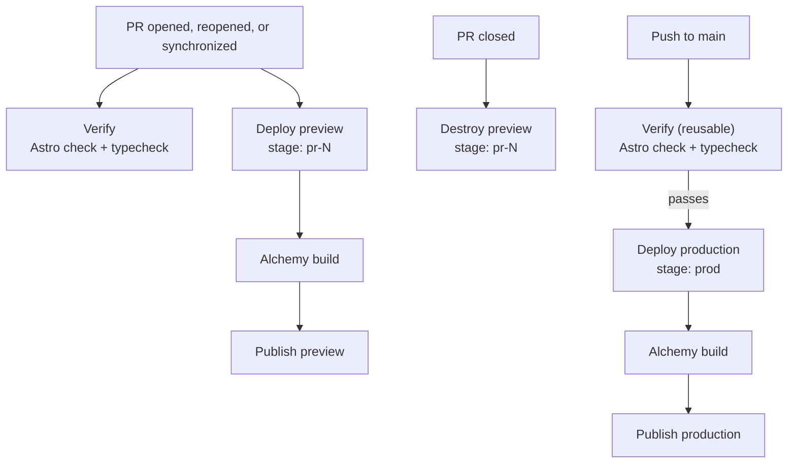

# mackie.underdown.wiki

> My personal website built with [Astro](https://astro.build/)

## Formatting

Astro files stay on Prettier with `prettier-plugin-astro`. Oxfmt's Astro support requires
a separate opt-in compiler, so it does not replace that path.

## CI/CD

For manual Alchemy commands, select the stage with `--stage` or `ALCHEMY_STAGE`.
The `STAGE` environment variable does not select an Alchemy stage.

### State-store cutovers

Changing the state-store Worker name selects a separate store; it does not copy existing state.
Keep the stack name, stage, logical resource IDs, and deployed Worker names unchanged so Alchemy
can recover resources with matching ownership tags. If ownership does not match, inspect the
resource before using `--adopt`.

Pause deployments during a cutover and verify each stage against the new store before resuming.
Do not destroy the shared state-store Worker or its secrets, because other projects may use them.
Old state still references live resources, so do not run `destroy` against the old store after recovery.
