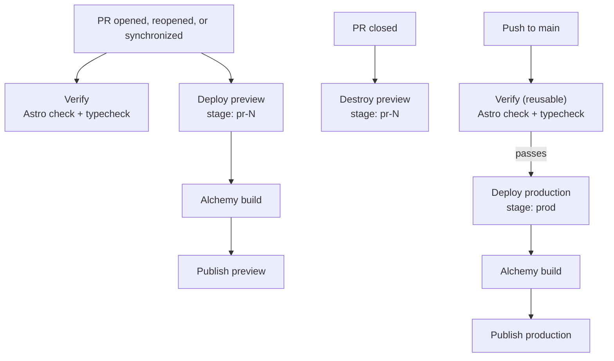

# mackie.underdown.wiki

> My personal website built with [Astro](https://astro.build/)

## CI/CD



## Cheat sheets

`/notes/cheatsheets` lists the printable sheets. `/cheatsheets/aerospace` is a
standalone black-and-white reference with US Letter (8.5 × 11 inch) print styles.

Refresh its tracked config snapshot from the dotfiles repo:

```sh
pnpm cheatsheets:sync ~/dotfiles/aerospace/.config/aerospace/aerospace.toml
pnpm --filter @mackie/web build
```

The page reads `apps/web/src/data/cheatsheets/aerospace.toml` at build time.
Review and commit the updated snapshot with any page changes. The build does not
read a developer's home directory or need the AeroSpace app. Native macOS sizing
shortcuts are separate reference content, not AeroSpace bindings.

To update the layout, edit `apps/web/src/pages/cheatsheets/aerospace.astro` and its
page helpers/styles. Keep the note list in `apps/web/src/data/notes/cheatsheets.md`.
Check changed sheets in the browser and print preview after a config update.
Print in portrait at 100% scale with browser headers and footers disabled.
